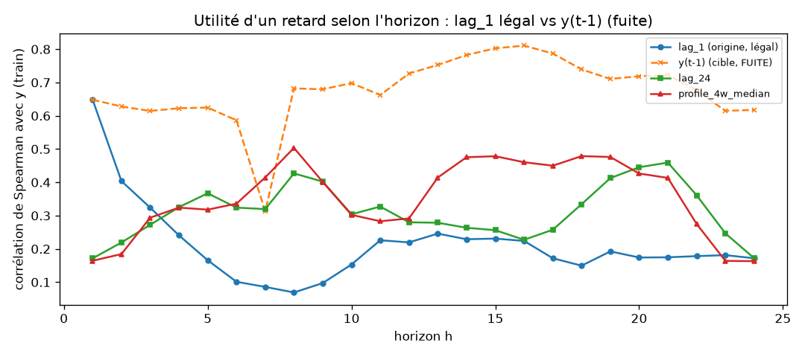
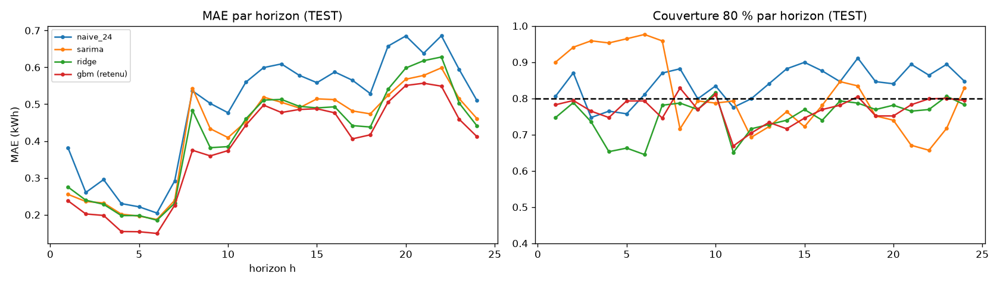

# Prévision horaire J+1 de la consommation électrique d'un logement : un protocole sans fuite temporelle

**Mohamedhen Vall Khaled (21026) · El Moustapha El Moustapha (22013)**

*AML313 — Séries temporelles de capteurs IoT · Master SupNum · Groupe 1*

---

**Résumé.** Nous prévoyons, chaque soir à minuit, les 24 consommations horaires du lendemain d'un logement français (jeu UCI *Individual Household Electric Power Consumption*, 2006-2010, pas d'une minute). Le protocole est entièrement chronologique : découpage figé avant toute modélisation, préparation causale journalisée, validation glissante avec écart de 24 h, sélection sur une validation interne au train puis sur un dev-set, et **une seule** évaluation pré-enregistrée sur le test. Sur 178 jours de test (juin-novembre 2010), un gradient boosting à perte absolue sur 20 variables causales atteint une MAE de **0,381 kWh [IC 95 % : 0,337-0,422]**, soit **−9,6 %** par rapport à SARIMA(1,0,1)(0,1,1)₂₄ (Δ = −0,041 [−0,058 ; −0,024]) et **−22 %** par rapport au naïf saisonnier. Ses intervalles à 80 % couvrent 76,8 % des heures, et il sous-prévoit le volume journalier de 8,8 %. Une démonstration contrôlée montre qu'une seule variable mal définie ($y_{t-1}$) « améliorerait » la MAE de 24 %.

## 1. Introduction et problème métier

Prévoir la consommation horaire du lendemain sert à piloter un contrat d'énergie : réserver un volume, décaler les usages vers les heures creuses, anticiper un dépassement de puissance. Une **sous-prévision** oblige à acheter en urgence, au prix fort ; une **sur-prévision** réserve de l'énergie pour rien. La difficulté est double. D'une part, la consommation d'un foyer dépend de décisions humaines peu prévisibles. D'autre part, l'évaluation est facilement **faussée par une fuite temporelle**, c'est-à-dire l'usage d'une information qui n'existe pas encore au moment de la prévision (Tashman, 2000 ; Bergmeir & Benítez, 2012). Notre contribution est moins un nouveau modèle qu'un **protocole vérifiable**, dans lequel chaque garantie anti-fuite est couverte par un test automatisé (35 tests).

## 2. Données

Le jeu UCI (Hébrail & Bérard, 2012) contient **2 075 259 minutes**, du 16/12/2006 17:24 au 26/11/2010 21:02 (1 441 jours), pour un logement de Sceaux (France). On y trouve la puissance active (kW, moyenne sur la minute), la puissance réactive, la tension, l'intensité et trois sous-compteurs (Wh par minute). La cible est l'**énergie horaire (kWh)**. Le **découpage chronologique a été figé avant toute modélisation** :

| Période | Dates | Heures | Heures observées |
|---|---|---|---|
| Train | 16/12/2006 → 30/11/2009 | 25 927 | 25 781 |
| Dev | 01/12/2009 → 31/05/2010 | 4 368 | 4 282 |
| Test (scellé) | 01/06/2010 → 26/11/2010 | 4 294 | 4 084 |

Les analyses qui orientent la modélisation (saisonnalité, ACF, stationnarité) n'utilisent que train + dev.

## 3. Diagnostic

**Horodatage.** La grille d'une minute est complète, strictement croissante, sans doublon. Aux changements d'heure, il n'y a ni heure manquante ni heure doublée. Pourtant, l'heure de la montée du matin en semaine ne saute pas de ±60 min (décalage observé : 0 à 15 min sur 6 changements) : l'horloge suit donc l'heure légale. On utilise un index local naïf.

**Valeurs manquantes.** Il y a deux marqueurs (`?` et le champ vide), ce qui donne **1,25 %** de minutes manquantes, **toujours des lignes entières** : ce sont des pannes d'acquisition, pas un capteur défaillant. Les 71 trous sont très inégaux : **6 trous de plus d'un jour concentrent 94,9 %** des minutes manquantes. Le mécanisme n'est **pas complètement aléatoire** : 3,7 % de manquants en 2010 contre moins de 0,8 % avant, 2,3 % le week-end contre 0,5-1,2 % en semaine, 4,6 % en août. De plus, la puissance médiane juste après un trou vaut 1,56 kW, contre 0,60 kW en général, ce qui évoque des coupures suivies du redémarrage des appareils. Nous le lisons comme un mécanisme plutôt MAR, avec une part possible de MNAR.

**Cohérence physique.** L'intensité recalculée $1000\sqrt{P^2+Q^2}/V$ est corrélée à 0,9994 avec l'intensité mesurée, et les sous-compteurs ne dépassent l'énergie totale que sur 0,002 % des minutes : les unités sont confirmées. Les valeurs extrêmes (jusqu'à 11,1 kW) sont physiquement possibles et **conservées**.

**Structure temporelle** (série horaire, train + dev). Profil journalier à deux pics (7 h en semaine, 19-21 h). Le week-end est différent, sans pic matinal. L'hiver consomme environ deux fois plus que l'été, avec des creux de vacances en août. ACF : ρ(1) = 0,72, ρ(6) ≈ 0, ρ(24) = 0,43, ρ(168) = 0,46. La saisonnalité est donc **faible**. Les tests ADF (p = 0,018) et KPSS (p ≥ 0,10) concordent sur la série journalière : pas de racine unitaire. **Hypothèse écrite avant tout modèle** : un gain de 10-20 % sur le naïf ; un gain bien supérieur devrait faire soupçonner une fuite.

## 4. Préparation (causale et journalisée)

* **Agrégation** : $E_h = \overline{P}_{\text{minutes valides}} \times 1\,\text{h}$ (kWh). Pour une heure incomplète, la somme des minutes serait biaisée vers le bas ; la moyenne ne l'est pas.
* **Validité d'une heure** : au moins 50 minutes valides. Le seuil a été choisi sur le train en simulant des heures partielles : l'erreur d'estimation (0,051 kWh) reste sous 10 % de l'erreur du naïf-24, critère fixé à l'avance.
* **La cible n'est jamais imputée.** Une copie remplie de façon **causale** sert uniquement à calculer les retards. Sur 300 trous simulés par durée (1 à 120 h, train), la meilleure méthode causale est la dernière valeur pour la 1ʳᵉ heure, puis la **médiane des 4 semaines passées à la même heure** (MAE ≈ 0,53, stable quelle que soit la durée). L'interpolation linéaire, qui utilise le bord droit du trou, n'est meilleure que pour les trous de 3 h ou moins. Comme on ne connaît pas la durée d'un trou en temps réel, la règle dépend du **temps écoulé** depuis son début.
* Chaque étape est enregistrée dans un journal JSON.

## 5. Variables

L'origine de la prévision est $o$ = 00:00 du jour J, et la cible est $t = o + h - 1$ avec $h = 1..24$. Une variable n'a le droit d'utiliser que des données jusqu'à $o - 1$. **`lag_1` est donc défini par rapport à l'origine** ($y_{o-1}$, 23 h la veille) : lu comme $y_{t-1}$, il serait inconnu dès $h \ge 2$. Les **26 variables** se répartissent en quatre groupes :

* **retards** : $y_{o-1}$, $y_{t-24}$, $y_{t-48}$, $y_{t-168}$, $y_{t-336}$, tous connus car $t-24 \le o-1$ ;
* **fenêtres arrêtées à l'origine** : moyenne et écart-type sur $[o-24, o-1]$, moyenne sur 168 h, moyenne de la même heure sur 7 jours, médiane sur 4 semaines, part d'heures remplies ;
* **calendrier** : heure, jour, week-end, sin/cos de l'heure, du jour de la semaine et du jour de l'année ;
* **jours fériés français**.

Un test **modifie toutes les données à partir de minuit du jour J** et vérifie que les 26 variables de J sont inchangées. Le même test échoue, comme il se doit, pour $y_{t-1}$.

La figure 1 justifie ce choix. Le `lag_1` légal passe d'une corrélation de 0,65 à $h = 1$ à 0,07 à $h = 8$, alors que $y_{t-1}$ reste autour de 0,6-0,8 à tous les horizons. Un modèle qui l'utiliserait paraîtrait excellent en validation et échouerait en production.

## 6. Baselines et modèles

* **Naïf saisonnier** $\hat y_t = y_{t-24}$ (exigé), et $y_{t-168}$.
* **Profil** : médiane de $y_{t-168k}$, $k = 1..4$. Le nombre de semaines et la statistique ont été choisis sur la validation interne.
* **SARIMA** (exigé), estimé par maximum de vraisemblance sur 8 semaines. Le filtre de Kalman gère nativement les manquants, donc sans imputation. Sur 24 candidats $(p,0,q)(P,D,Q)_{24}$ × {brut, log}, c'est **la partie saisonnière qui compte** : $(0,1,1)_{24}$ l'emporte nettement (0,467 contre 0,525-0,660), et les ordres non saisonniers ne changent la MAE que de 0,0005 au plus. Il est retenu en (1,0,1)(0,1,1)₂₄. Les résidus ne sont pas autocorrélés (Ljung-Box, p ≥ 0,56 aux retards 24, 48 et 168).
* **Ridge**, avec des termes fixes heure × week-end et heure × `lag_1`, pour qu'un modèle linéaire puisse représenter deux pics et un poids de `lag_1` qui varie avec l'horizon.
* **Gradient boosting** (`HistGradientBoostingRegressor`, inspiré de LightGBM, Ke et al., 2017). La **perte absolue** vise la médiane conditionnelle, qui minimise la MAE. L'arrêt précoce est désactivé, car il réserve des lignes **tirées au hasard**.
* **Intervalles à 80 %** : quantiles empiriques des erreurs passées pour les naïfs, intervalle gaussien pour SARIMA, et **conformal « split » par heure** (Shafer & Vovk, 2008) pour Ridge et le boosting, avec 91 jours de calibration avant chaque réapprentissage.

## 7. Protocole de validation

À chaque origine, c'est le **validateur** qui coupe les données avant $o$. Les modèles à variables les **recalculent** à partir de cet historique, sans jamais lire une matrice précalculée. Un modèle « espion » vérifie qu'aucune donnée de l'origine ou postérieure n'est visible. Les paramètres sont réappris tous les 28 jours, sur des données qui finissent 24 h avant le début du pli (*gap*). Les hyperparamètres sont choisis sur une **validation interne au train** (01/09-30/11/2009, 91 origines), et les modèles sont comparés sur le dev (182 origines). Toutes les méthodes sont notées sur **les mêmes heures observées**. Les IC à 95 % viennent d'un **bootstrap par blocs d'une semaine** (Künsch, 1989), appliqué aux différences d'erreur **appariées**, car les erreurs sont autocorrélées. Le choix final a ensuite été **pré-enregistré** dans `config.yaml`, avec une empreinte SHA-256 : toute modification fait refuser l'évaluation du test.

## 8. Résultats

**Dev-set** (4 282 h). Naïf-24 : 0,647 (MASE 0,977) ; naïf-168 : 0,620 ; profil : 0,517 ; **SARIMA : 0,492** (0,742) ; Ridge : 0,479 ; **boosting : 0,458** (0,692), soit Δ = −0,033 [−0,053 ; −0,015] par rapport à SARIMA. Le boosting est le meilleur sur les 7 plis. La perte absolue l'emporte nettement sur la perte quadratique en validation interne (0,405 contre 0,427).

**Test** (178 jours, 4 063 heures communes, évalué une seule fois) :

| Modèle | MAE (kWh) [IC 95 %] | MASE | Δ vs SARIMA [IC 95 %] | Couverture 80 % | Score d'intervalle | Biais de volume |
|---|---|---|---|---|---|---|
| Naïf-24 | 0,490 [0,425 ; 0,547] | 0,739 | +0,068 | 0,840 | 2,41 | +0,3 % |
| SARIMA | 0,422 [0,387 ; 0,457] | 0,636 | — | 0,811 | 2,04 | −1,1 % |
| Ridge | 0,416 [0,386 ; 0,448] | 0,627 | −0,006 [−0,018 ; +0,006] | 0,749 | 1,98 | +0,8 % |
| **Boosting** | **0,381 [0,337 ; 0,422]** | **0,575** | **−0,041 [−0,058 ; −0,024]** | 0,768 | **1,97** | **+8,8 %** |

*Biais de volume : (réel − prévu) / énergie journalière ; une valeur positive signifie une sous-prévision.*

Le gain du boosting sur SARIMA est **cohérent** avec le dev-set (les IC se recouvrent) et reste dans la fourchette annoncée. Ridge, qui battait SARIMA de justesse sur le dev, **ne le bat plus** sur le test. Le boosting est le meilleur aux 24 horizons et chaque mois. Son gain le plus fort est à la **montée du matin** ($h = 8$ : 0,375 contre 0,543 pour SARIMA), car le réveil dépend du type de jour. En août (vacances), le naïf-24 devient compétitif (0,255) : la consommation est basse et régulière. SARIMA et Ridge (0,33-0,34) continuent de prévoir le profil habituel, alors que le boosting (0,249) s'adapte au niveau grâce à ses fenêtres. Les erreurs sont plus faibles qu'au dev-set parce que l'été consomme moins (22,0 contre 29,2 kWh par jour) : seule la comparaison **sur les mêmes heures** est valable.

## 9. Ablation et rôle des variables

Ablation par groupes sur le dev, avec le même protocole et les mêmes heures (MAE du boosting) : retards seuls **0,500**, pas mieux que SARIMA ; + calendrier **0,462** ; + fenêtres 0,474 ; retards + fenêtres + calendrier **0,457** ; + jours fériés 0,458 ; tout sauf `lag_1` 0,458, mais la MAE de $h = 1..3$ passe de 0,221 à **0,241** (+9 %). **Le calendrier est le groupe le plus utile, les jours fériés n'apportent rien de mesurable** : l'effet existe (+7 % à saison égale) mais repose sur trop peu de jours. `lag_1` n'aide que les premières heures. La configuration retenue (20 variables) est la plus simple à performance égale.

Une revue descriptive des 20 variables montre une **forte redondance**. Retirer une variable et réentraîner ne dégrade significativement la MAE que pour `lag_168`, et `is_weekend` n'est jamais utilisée. Par groupe, seule l'information **heure de la journée** est irremplaçable (+0,017 [+0,008 ; +0,026]). Un modèle à 8 variables obtient 0,459 (différence non significative). **Démonstration de fuite** : le même boosting avec $y_{t-1}$ atteint 0,346 sur le dev (−24 %), soit plus que tous les gains légitimes réunis.

## 10. Limites

1. **Intervalles** : 76,8 % de couverture au lieu de 80 %. Le conformal « split » suppose des erreurs échangeables, ce qui n'est plus vrai quand la saison change entre la calibration et la prévision. SARIMA atteint 81 % au total, mais avec 90-98 % la nuit et 66 % en soirée (variance qui dépend de l'heure).
2. **Biais de volume** : la perte absolue optimise la MAE horaire mais **sous-prévoit le volume de 8,8 %**. Pour réserver un volume, il faudrait la perte quadratique ou une correction de biais.
3. **Sensibilité aux trous** : après les longs trous d'août et de septembre, l'erreur du boosting augmente de 18 %, contre 4-10 % pour les autres. `frac_filled_168` n'a pas appris à compenser, faute d'exemples dans le dev-set.
4. **Ce que les données ne contiennent pas** : pas de température (le chauffage est probablement électrique), et pas de vacances scolaires (aucun calendrier officiel vérifiable n'a été utilisé). Les pires jours sont des réveillons, des retours de vacances et des week-ends atypiques.
5. **Généralisation** : un seul logement, données de 2006-2010, et l'hypothèse que l'historique de la veille est disponible à minuit.

## 11. Conclusion

Avec un protocole chronologique, vérifié par des tests et pré-enregistré, un gradient boosting à perte absolue sur des variables strictement causales améliore la prévision horaire J+1 de **9,6 %** par rapport à SARIMA et de **22 %** par rapport au naïf saisonnier, de façon significative et cohérente entre dev et test. L'essentiel du gain vient d'une information simple, l'heure combinée au type de jour, que SARIMA ne voit pas. La démonstration de fuite rappelle qu'un gain spectaculaire est plus souvent le signe d'une erreur de protocole que d'un meilleur modèle. Travaux futurs : conformal adaptatif (Gibbs & Candès, 2021), un modèle pour le volume, la température et les vacances scolaires, et un modèle réduit à environ 8 variables, à valider sur des données nouvelles.

**Reproductibilité.** `python main.py` télécharge les données (avec vérification SHA-256) et relance les 7 étapes ; l'environnement est figé et la graine fixée ; 35 tests unitaires.

## Références

* Bergmeir, C., Benítez, J. M. (2012). On the use of cross-validation for time series predictor evaluation. *Information Sciences*, 191, 192-213.
* Gibbs, I., Candès, E. (2021). Adaptive conformal inference under distribution shift. *NeurIPS*.
* Gneiting, T., Raftery, A. E. (2007). Strictly proper scoring rules, prediction, and estimation. *JASA*, 102(477), 359-378.
* Hébrail, G., Bérard, A. (2012). Individual Household Electric Power Consumption [jeu de données]. UCI Machine Learning Repository.
* Hyndman, R. J., Koehler, A. B. (2006). Another look at measures of forecast accuracy. *International Journal of Forecasting*, 22(4), 679-688.
* Ke, G. et al. (2017). LightGBM: A highly efficient gradient boosting decision tree. *NeurIPS*.
* Künsch, H. R. (1989). The jackknife and the bootstrap for general stationary observations. *Annals of Statistics*, 17(3), 1217-1241.
* Shafer, G., Vovk, V. (2008). A tutorial on conformal prediction. *JMLR*, 9, 371-421.
* Tashman, L. J. (2000). Out-of-sample tests of forecasting accuracy: an analysis and review. *International Journal of Forecasting*, 16(4), 437-450.
