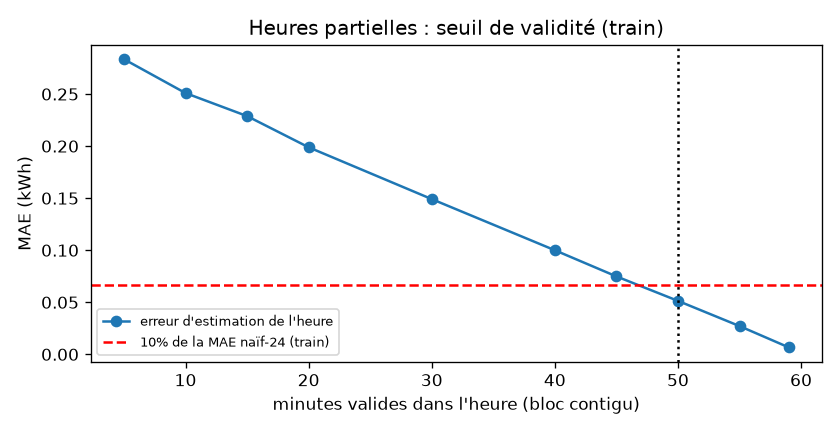
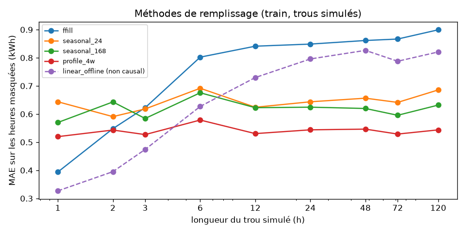
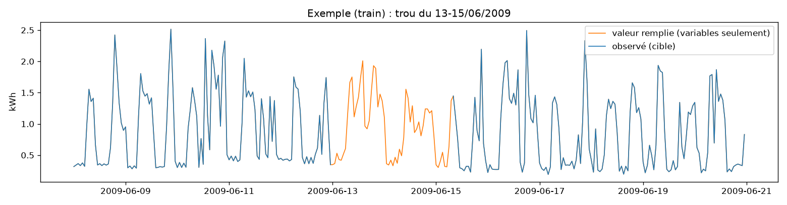

# Phase 2 — Préparation des données

*Commande : `python main.py --stage preprocess` · journal : `data/processed/preprocessing_log.json` · sortie : `data/processed/hourly.csv` · tests : `tests/test_preprocessing.py` (16 tests au total, tous OK).*

## 0. Principes

1. **La cible n'est jamais remplie.** Une heure non observée reste `NaN` dans `energy_kwh`. Elle n'est ni apprise, ni évaluée. On ne mesure jamais un modèle sur une valeur inventée.
2. **Le remplissage sert seulement aux variables.** `energy_filled` permet de calculer `lag_24`, `lag_168` et les fenêtres quand une valeur **passée** manque.
3. **Tout est causal.** Une valeur remplie à l'instant t n'utilise que des données antérieures à t. C'est vérifié par un test qui **modifie le futur** et contrôle que rien ne change avant t.
4. **Les règles sont choisies sur le train seulement**, avec des critères écrits **à l'avance** dans `config.yaml`. Les valeurs choisies sont recalculées à chaque exécution et enregistrées dans le journal.
5. **Rien n'est supprimé en silence.** Chaque heure reste dans la table, avec `n_valid` (minutes valides), `observed` (vrai/faux) et `fill_method`.

## 1. Pipeline (étapes journalisées)

| # | Étape | Effet mesuré |
|---|---|---|
| 1 | Grille minute : tri, suppression des doublons, réindexation | 2 075 259 lignes en entrée et en sortie ; 0 doublon ; 0 minute ajoutée ; 25 979 minutes `NaN` |
| 2 | Agrégation horaire | 34 589 heures : 34 085 complètes, 83 partielles, 421 vides |
| 3 | Règle de validité : `n_valid ≥ 50` | **34 147 heures observées**, 442 non observées (dont 21 heures partielles écartées) |
| 4 | Remplissage causal (variables seulement) | 15 heures par `ffill`, 426 par `profile_4w`, 1 non remplie (la toute première heure du fichier : 36 min et aucun passé) |

**Fonctions d'agrégation** (selon le sens physique de chaque variable) :

| Variable | Nature | Agrégation horaire |
|---|---|---|
| `Global_active_power` → **`energy_kwh`** | puissance moyenne sur la minute (kW) | **moyenne des minutes valides × 1 h** = kWh |
| `Voltage`, `Global_intensity`, `Global_reactive_power` | grandeurs instantanées moyennées | moyenne |
| `Sub_metering_1/2/3` | énergie de la minute (Wh) | moyenne × 60 = **Wh par heure** (somme ramenée à 60 min, sans biais si l'heure est partielle) |

Utiliser les minutes valides d'une heure pour estimer cette heure est **causal à l'échelle horaire** : la valeur horaire n'existe qu'une fois l'heure terminée.

## 2. Choix n°1 : combien de minutes pour qu'une heure soit « observée » ?

**Expérience (train).** On prend 3 000 heures **complètes** du train. Pour chacune, on ne garde qu'un **bloc contigu** de k minutes à une position au hasard (les vrais trous sont contigus), on estime l'heure par la moyenne de ce bloc, et on compare à la vraie valeur.

| Minutes gardées k | 20 | 30 | 40 | 45 | **50** | 55 | 59 |
|---|---|---|---|---|---|---|---|
| MAE d'estimation (kWh) | 0,199 | 0,149 | 0,100 | 0,075 | **0,051** | 0,027 | 0,007 |
| en % de la moyenne horaire | 18,2 % | 13,6 % | 9,1 % | 6,8 % | **4,7 %** | 2,5 % | 0,6 % |

**Critère fixé à l'avance :** l'erreur d'estimation d'une heure doit rester **≤ 10 % de l'erreur du naïf-24** sur le train (0,661 kWh), soit ≤ 0,066 kWh. Ainsi, une heure partielle acceptée ne peut pas fausser la comparaison des modèles. → **Seuil retenu : 50 minutes.** L'impact est minime : seules 21 heures sont écartées. Le seuil de 45 min utilisé pour l'exploration en phase 1 est remplacé ; les baselines seront recalculées en phase 3 avec la règle finale.

## 3. Choix n°2 : comment remplir un trou de façon causale ?

**Méthodes comparées** (toutes causales, sauf la dernière, gardée comme repère) :

| Méthode | Formule | Idée |
|---|---|---|
| `ffill` | $\hat y_t = y_{\text{dernière obs.}}$ | la consommation change peu d'une heure à l'autre (ρ(1) = 0,72) |
| `seasonal_24` | $\hat y_t = \tilde y_{t-24}$ | même heure la veille |
| `seasonal_168` | $\hat y_t = \tilde y_{t-168}$ | même heure, même jour, la semaine d'avant |
| `profile_4w` | $\hat y_t = \operatorname{moy}\{y_{t-168k},\ k=1..4\}$ (valeurs observées) | moyenne de 4 semaines → moins de bruit |
| *linéaire (non causale)* | interpolation entre les deux bords du trou | **lit la valeur après le trou** → interdite en temps réel |

**Expérience (train).** Pour chaque durée L, on masque **300 trous artificiels** dans des zones complètes du train (avec au moins 4 semaines de passé), puis on mesure la MAE sur les heures masquées.

| Durée du trou (h) | ffill | seasonal_24 | seasonal_168 | **profile_4w** | *linéaire (triche)* |
|---|---|---|---|---|---|
| 1 | **0,394** | 0,644 | 0,570 | 0,520 | *0,327* |
| 2 | 0,548 | 0,591 | 0,643 | **0,543** | *0,395* |
| 3 | 0,622 | 0,618 | 0,584 | **0,527** | *0,474* |
| 6 | 0,802 | 0,692 | 0,676 | **0,579** | *0,627* |
| 12 | 0,841 | 0,624 | 0,622 | **0,530** | *0,730* |
| 24 | 0,849 | 0,644 | 0,624 | **0,544** | *0,796* |
| 72 | 0,867 | 0,641 | 0,596 | **0,529** | *0,788* |
| 120 | 0,899 | 0,686 | 0,632 | **0,544** | *0,821* |

**Lecture :**
* Pour **1 h**, la dernière valeur gagne nettement (0,394) : l'heure d'après ressemble à l'heure d'avant.
* À partir de **2 h**, `profile_4w` gagne, et son erreur **ne grandit pas avec la durée** (environ 0,53-0,55 kWh) : il ne dépend pas du bord du trou.
* L'interpolation linéaire **triche** mais ne gagne que pour les trous de **3 h ou moins**. Pour les longs trous, le profil causal fait **mieux** qu'elle. Interdire l'interpolation ne coûte donc presque rien ici.

**Règle retenue (choisie automatiquement) :** 1ʳᵉ heure d'un trou → `ffill` ; à partir de la 2ᵉ heure → `profile_4w`.

**Subtilité de causalité.** En temps réel, on ne connaît pas la durée finale d'un trou au moment où il commence. La règle s'applique donc selon le **temps écoulé depuis le début du trou**, qui est connu. Par exemple, la 1ʳᵉ heure d'un trou de 5 jours est remplie par `ffill`, comme un trou d'1 h. Pour la même raison, la colonne « durée totale du trou » a été **retirée** de la table produite : elle n'est connue qu'à la fin du trou, et serait une fuite si elle devenait une variable.

## 4. Ce qui reste par période

| Période | Heures | Observées (cible utilisable) | Remplies (variables seulement) |
|---|---|---|---|
| Train | 25 927 | 25 781 | 146 |
| Dev | 4 368 | 4 282 | 86 |
| Test | 4 294 | 4 084 | 210 |

Pour le test, on n'a compté que des **heures**, sans regarder les valeurs : le test reste scellé.

## 5. Tests de la phase 2

| Test | Ce qu'il garantit |
|---|---|
| `test_minute_grid_reindexes_absent_and_duplicate_rows` | la grille est complète, triée et sans doublon, même si l'entrée est désordonnée |
| `test_hourly_energy_and_submeter_rescaling` | 2 kW pendant 1 h = 2 kWh, même si la moitié des minutes manquent |
| `test_validity_rule_sets_nan_but_keeps_row` | une heure trop incomplète devient `NaN`, mais **sa ligne est gardée** |
| `test_fill_methods_are_causal` (×4) | modifier le futur ne change **aucune** valeur remplie avant t |
| `test_linear_interpolation_is_not_causal` | montre **pourquoi** l'interpolation est exclue |
| `test_causal_fill_switches_on_elapsed_time…` | la règle change de méthode selon le temps écoulé, ne touche jamais une valeur observée, et reste causale |

## 6. Ce que cela implique pour la suite

* **Entraînement et évaluation** : uniquement les heures avec `observed == True`. Les variables sont calculées sur `energy_filled`.
* **Ablation possible** : enlever les lignes d'entraînement dont les retards viennent d'une valeur remplie, pour vérifier que le remplissage ne biaise pas le modèle.
* **Piste pour la phase 3** : en remplissage, `profile_4w` fait ≈ 0,53 kWh contre 0,66 kWh pour le naïf-24 sur le train. Une moyenne des 4 dernières semaines à la même heure est donc un **repère simple et fort**. On l'ajoutera comme troisième baseline (« profil saisonnier »), en plus du naïf-24 et de SARIMA exigés.
