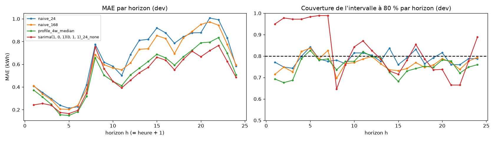
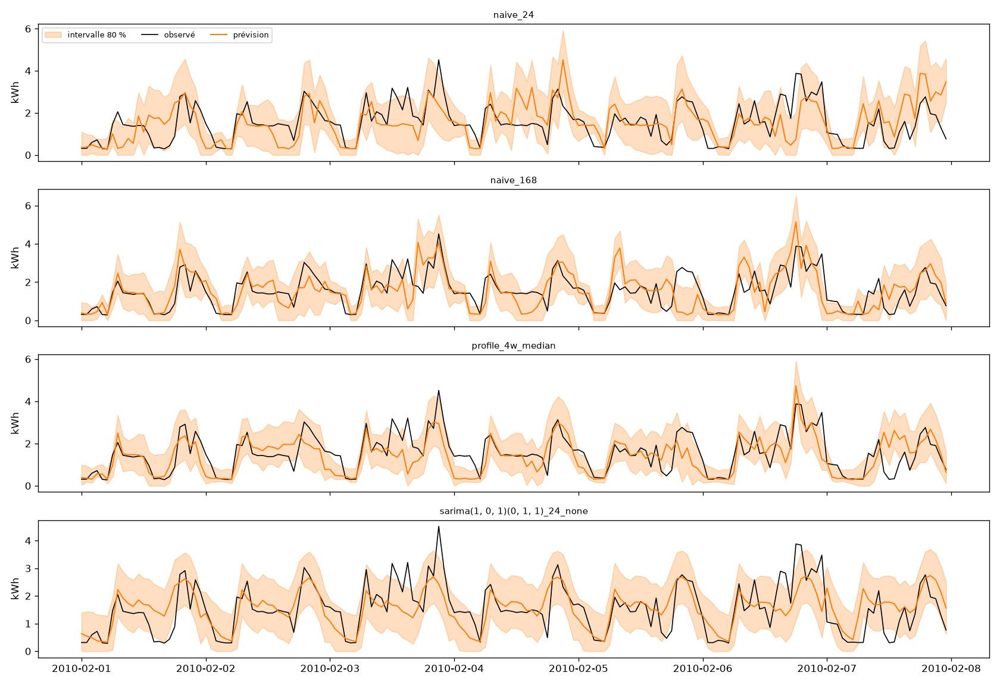

# Phase 3 — Baselines et cadre d'évaluation

*Commande : `python main.py --stage baselines` · chiffres : `reports/03_baselines_results.json` · prévisions : `reports/03_forecasts_dev.csv` · figures : `reports/figures/03_*.png` · tests : `tests/test_validation.py` (22 tests au total, tous OK).*

## 1. Protocole (fixé avant de voir les résultats)

| Élément | Choix | Raison |
|---|---|---|
| Origine de prévision | 00:00 du jour J, cibles : les 24 heures du jour J (h = 1…24) | prévision J+1 « la veille au soir » |
| Information disponible | le modèle reçoit **seulement** `data[: origine − 1 h]` ; la coupe est faite **par le validateur**, pas par le modèle | une erreur dans un modèle ne peut pas créer de fuite |
| Réestimation des paramètres | au début de chaque **pli de 28 jours**, sur des données qui finissent **24 h avant** le début du pli (`gap`) | situation réelle : on réapprend de temps en temps, on met à jour l'état chaque jour |
| Choix des réglages | **validation interne au train** : 01/09 → 30/11/2009 (91 origines) | le dev-set sert à **comparer** les baselines, pas à régler leurs paramètres |
| Évaluation | dev-set : 01/12/2009 → 31/05/2010 (182 origines, 7 plis ; une première version sautait le 01/12 à cause d'une erreur d'arrondi, corrigée et couverte par un test) ; **4 282 heures observées, les mêmes pour tous les modèles** | comparaison juste |
| Incertitude | IC à 95 % par **bootstrap par blocs d'une semaine** ; différence de MAE **appariée** avec le naïf-24 | les erreurs sont autocorrélées : un bootstrap heure par heure donnerait des IC trop étroits |
| Intervalle à 80 % | naïfs et profil : **quantiles empiriques** des erreurs passées de la méthode, par heure (365 derniers jours avant le pli) ; SARIMA : intervalle **gaussien** du modèle | chaque méthode avec son intervalle « naturel » |

**Tests du pare-feu anti-fuite** (`tests/test_validation.py`) : un modèle « espion » vérifie qu'il ne voit **jamais** de donnée à l'origine ou après, et que les paramètres s'arrêtent bien **25 h** avant le pli (gap de 24 h + 1 h). Autres tests : modifier le futur ne change pas la prévision du naïf, et un naïf avec m < 24 est **refusé** (ce serait une fuite).

## 2. Baselines comparées

| Baseline | Formule | Idée |
|---|---|---|
| **naïf-24** (exigée) | $\hat y_t = y_{t-24}$ | demain ressemble à aujourd'hui |
| naïf-168 | $\hat y_t = y_{t-168}$ | demain ressemble au même jour de la semaine dernière |
| profil 4 semaines (médiane) | $\hat y_t = \operatorname{méd}\{y_{t-168k}, k=1..4\}$ | même jour et même heure, débruité sur 4 semaines |
| **SARIMA** (exigée) | $(p,0,q)(P,D,Q)_{24}$, ajusté par maximum de vraisemblance sur les 8 dernières semaines | dynamique de court terme + saisonnalité journalière |

Le filtre de Kalman de SARIMA **gère les valeurs manquantes** : SARIMA reçoit la série observée, avec ses trous, et n'a besoin d'**aucun** remplissage.

## 3. Sélection des réglages (validation interne au train)

**Profil.** Grille : 2, 4, 6 ou 8 semaines × moyenne ou médiane. Le meilleur est **4 semaines, médiane** (MAE 0,442). L'écart avec 4 semaines en moyenne est minime (0,443). Moins de semaines donne plus de bruit (2 sem. : 0,469) ; plus de semaines réagit trop lentement aux changements de saison (8 sem. : 0,456-0,471).

**SARIMA.** Grille de 24 candidats : $(p,q) \in \{(1,0),(1,1),(2,0),(2,1)\}$ × saisonnier $(P,D,Q) \in \{(1,0,0),(1,0,1),(0,1,1)\}$ × transformation {aucune, log}. Les ordres de départ viennent de la phase 1 (PACF : pic à 1, puis pics vers 23-24 ; ADF/KPSS : d = 0).

| Partie saisonnière | MAE (sans log) | MAE (log) | Couverture 80 % (sans log / log) |
|---|---|---|---|
| (1,0,0)₂₄ | 0,660 | 0,702 | 0,64 / 0,59 |
| (1,0,1)₂₄ | 0,525 | 0,596 | 0,71 / 0,72 |
| **(0,1,1)₂₄** | **0,467** | 0,473 | 0,73 / **0,81** |

*(Pour chaque ligne, on donne le meilleur des 4 ordres non saisonniers. Leurs écarts sont ≤ 0,001 kWh.)*

**Lecture :**
* **C'est la partie saisonnière qui compte**, pas la partie courte : avec $(0,1,1)_{24}$, les 4 ordres $(p,q)$ donnent la même MAE à 0,0005 près. Le critère fixé à l'avance (la plus petite MAE) retient $(1,0,1)(0,1,1)_{24}$. $(1,0,0)(0,1,1)_{24}$ est **équivalent** (0,4677 contre 0,4672) et a l'AIC le plus bas : on le gardera comme variante parcimonieuse.
* $(0,1,1)_{24}$ revient à un **lissage exponentiel du profil journalier** : $y_t - y_{t-24} = \varepsilon_t + \Theta\varepsilon_{t-24}$. La prévision est une **moyenne pondérée des jours passés à la même heure**, plus récente que le naïf-24 et moins bruitée. C'est un cousin du profil 4 semaines.
* **Différenciation saisonnière (D = 1) contre AR saisonnier (P = 1)** : un AR saisonnier stationnaire ramène la prévision vers la **moyenne globale**. Or le niveau journalier varie avec la saison (hiver / été). La différenciation s'adapte à ce niveau, d'où son net avantage (0,47 contre 0,52-0,66). Cela ne contredit pas la phase 1 (ADF/KPSS : d = 0 sur la série **journalière**) : ici, on différencie la saisonnalité **horaire**, pas le niveau.
* **Log** : MAE un peu moins bonne (+1,3 %) mais **intervalles mieux calibrés** (0,81 contre 0,73). Critère choisi à l'avance : la MAE → sans log. On garde l'idée pour la phase 5 (intervalles).
* **Résidus de SARIMA** (dernier ajustement) : Ljung-Box p = 0,97 (lag 24), 0,58 (lag 48), 0,56 (lag 168). **Il ne reste pas d'autocorrélation détectable** dans les résidus en échantillon.

## 4. Résultats sur le dev-set

| Modèle | MAE (kWh) [IC 95 %] | MASE | Δ MAE vs naïf-24 [IC 95 %] | Biais | Couverture 80 % | Largeur moyenne (kWh) |
|---|---|---|---|---|---|---|
| naïf-24 | 0,647 [0,603 ; 0,692] | 0,977 | — | −0,001 | 0,788 | 1,87 |
| naïf-168 | 0,620 [0,574 ; 0,668] | 0,935 | −0,028 [−0,063 ; +0,011] | −0,006 | 0,766 | 1,75 |
| profil 4 sem. (médiane) | 0,517 [0,474 ; 0,564] | 0,780 | **−0,131 [−0,165 ; −0,092]** | +0,014 | 0,754 | 1,54 |
| **SARIMA (1,0,1)(0,1,1)₂₄** | **0,492 [0,460 ; 0,525]** | **0,742** | **−0,156 [−0,183 ; −0,124]** | −0,018 | 0,829 | 1,68 |

Échelle de la MASE : MAE du naïf-24 sur le train = 0,663 kWh.

**Ce qu'on peut affirmer :**
* **SARIMA est la meilleure baseline** : −24 % de MAE par rapport au naïf-24 exigé, avec un IC qui exclut 0. Il bat aussi le profil 4 semaines, de peu mais de façon significative : Δ = −0,025 kWh, IC [−0,046 ; −0,005].
* **Le naïf-168 n'est pas significativement meilleur que le naïf-24** (l'IC contient 0), malgré ρ(168) > ρ(24).
* **Pas de biais** (moins de 0,02 kWh pour tous). Les sous-prévisions et les sur-prévisions pèsent à peu près autant dans la MAE.
* **Stabilité dans le temps** : SARIMA est le meilleur sur **5 plis sur 7** (MAE 0,39 à 0,54). Il est à égalité avec le profil fin décembre (0,541 / 0,541), et le profil gagne de peu à partir du 23/03 (0,404 contre 0,420). Les mois de printemps sont plus faciles pour tous (consommation plus régulière).

**Par horizon :**
* **h = 1-2 (minuit-2 h)** : SARIMA **0,24-0,26** contre 0,31-0,41 pour les autres. C'est le seul qui utilise la **dernière valeur observée** (ρ(1) = 0,72). Cet avantage disparaît dès h ≈ 4.
* **h = 4-6 (nuit)** : erreurs les plus faibles pour tous (≈ 0,15-0,24 kWh), car la consommation de nuit est stable.
* **h = 8 (7 h, montée du matin)** et **h = 20-22 (soir)** : erreurs les plus fortes (0,65-1,0 kWh). L'**heure exacte** du réveil ou du repas varie d'un jour à l'autre, et un décalage d'une heure crée une grosse erreur.

## 5. Les intervalles à 80 % : une couverture globale trompeuse

| Modèle | Couverture h = 1-6 | Couverture h = 7-24 | Globale |
|---|---|---|---|
| naïf-24 | 0,78 | 0,79 | 0,79 |
| profil 4 sem. | 0,74 | 0,76 | 0,75 |
| SARIMA (gaussien) | **0,974** | 0,781 | 0,829 |

* Les intervalles **empiriques par heure** (naïfs, profil) sont **réguliers** sur toute la journée, mais un peu **trop étroits** (0,75-0,79). Ils sont calibrés sur les 365 derniers jours, alors que l'hiver du dev-set est plus variable que la moyenne de l'année.
* L'intervalle **gaussien** de SARIMA a la **même largeur à toute heure** : **trop large la nuit** (95-99 %) et **trop étroit aux pics** (64 % à 7 h, 66 % à 20-21 h). Les 82,9 % globaux sont une **moyenne de deux erreurs opposées**. C'est l'**hétéroscédasticité** de la consommation : sa variance dépend de l'heure. On le voit sur la semaine d'exemple : bande large la nuit, bande dépassée aux pics.
* **Conséquence pour la phase 5** : on donnera toujours la couverture **par horizon**, pas seulement la moyenne. On testera des intervalles **empiriques par heure** (conformes) aussi pour SARIMA, Ridge et le gradient boosting, ainsi que SARIMA sur log (mieux calibré, §3).

## 6. Les grosses erreurs

Les pires jours (MAE journalière) sont les **mêmes pour tous les modèles** :

| Jour | Ce qui s'est passé | Énergie réelle / prévue par SARIMA |
|---|---|---|
| jeu. 24/12/2009 | **réveillon de Noël** : cuisine et invités | 48,4 / 29,4 kWh |
| dim. 28/02/2010 | **logement presque vide** (absence probable ; cause non vérifiable dans les données) | 11,9 / 32,4 kWh |
| sam. 19/12 et dim. 20/12/2009 | premier week-end des vacances scolaires de Noël | 36,7 / 30,8 (SARIMA) et 19,1 / 34,6 kWh (profil) |
| lun. 22/02/2010 (naïf-24) | lendemain d'un dimanche très chargé, recopié tel quel | 24,6 / 45,7 kWh |

**Lecture métier :**
* **Sous-prévision** (réveillon) : le fournisseur doit acheter du courant en urgence, au prix fort. Pour un particulier en tarif heures pleines / heures creuses, c'est une facture plus élevée que prévu.
* **Sur-prévision** (logement vide) : on réserve de l'énergie pour rien.
* Avec un historique de consommation seul, **aucune baseline ne peut prévoir ces jours**. Ils dépendent du **calendrier** : jours fériés, veilles de fête, **vacances scolaires** (zone C, Île-de-France). Ce calendrier est **connu à l'avance**, donc **utilisable sans fuite**. C'est l'apport attendu des variables de calendrier (phase 4), à mesurer par ablation.

## 7. Ce qui change pour la suite

1. **La barre à battre est SARIMA : MAE 0,492 kWh, MASE 0,742.** L'hypothèse de la phase 1 (gain de 10-20 %) visait le naïf-24. Par rapport à SARIMA, un gain de **plus de 5-10 %** serait déjà un bon résultat. Un gain beaucoup plus grand devra faire chercher une **fuite**.
2. **Ce que Ridge et le gradient boosting peuvent apporter** : le calendrier (fériés, vacances, veilles de fête), l'interaction heure × type de jour, et `lag_1` = dernière valeur connue à l'origine (utile seulement pour h ≤ 3, comme on le voit avec SARIMA).
3. **Intervalles** : calibrer **par horizon**, et juger avec la couverture par heure et le score d'intervalle (Winkler), pas avec la seule couverture globale.
