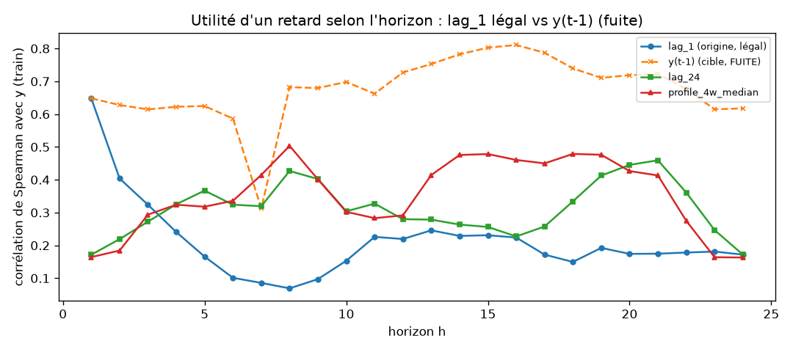

# Phase 4 — Variables (feature engineering)

*Commande : `python main.py --stage features` · code : `src/features/engineering.py` · matrice : `data/processed/features.csv` · chiffres : `reports/04_features_results.json` · tests : `tests/test_features.py` (29 tests au total, tous OK).*

## 1. Règle de causalité

La prévision part de l'origine $o$ = 00:00 du jour J. Pour une heure cible $t = o + h - 1$ ($h = 1 \dots 24$), une variable **ne peut utiliser que des données jusqu'à $o - 1$** (23:00 la veille).

Il y a deux façons légales de construire un retard :

| Famille | Calculée par rapport à | Exemple | Pourquoi c'est légal |
|---|---|---|---|
| **Retards « à l'origine »** | l'origine $o$ | `lag_1` = $y_{o-1}$, fenêtres sur $[o-24, o-1]$ | par définition, ce sont des données d'avant $o$ |
| **Retards « à la cible », ≥ 24 h** | la cible $t$ | `lag_24` = $y_{t-24}$, `lag_168` | $h \le 24 \Rightarrow t - 24 \le o - 1$ |

**Test de causalité** (`test_features_of_day_D_only_use_data_before_D`) : on **remplace toutes les données à partir de minuit du jour J** (×7 + 3, et le masque « observé » inversé), puis on vérifie que les **26 variables des 24 heures de J sont identiques**. Le test est fait sur 3 jours, dont le 24/12. Le même test **échoue volontairement** pour le $y_{t-1}$ « naïf » (`test_leaky_lag_1_fails_the_same_test`) : il démontre la fuite.

## 2. La question de `lag_1`

Le sujet demande `lag_1`. Si on le lit comme $y_{t-1}$ (l'heure juste avant **la cible**), il n'est connu que pour $h = 1$. Pour $h \ge 2$, c'est une **fuite** (TP2, fuite n°2). On le définit donc comme **la dernière valeur connue à l'origine**, $y_{o-1}$, identique pour les 24 heures du jour.

Corrélation de Spearman avec la cible, **par horizon**, sur le train :

| h | 1 | 2 | 3 | 6 | 8 | 12 | 16 | 24 |
|---|---|---|---|---|---|---|---|---|
| `lag_1` (origine, **légal**) | **0,65** | 0,40 | 0,32 | 0,10 | 0,07 | 0,22 | 0,22 | 0,17 |
| $y_{t-1}$ (cible, **fuite**) | 0,65 | 0,63 | 0,61 | 0,59 | 0,68 | 0,73 | **0,81** | 0,62 |
| `lag_24` | 0,17 | 0,22 | 0,27 | 0,32 | 0,43 | 0,28 | 0,23 | 0,17 |
| `profile_4w_median` | 0,16 | 0,18 | 0,29 | 0,34 | 0,50 | 0,29 | 0,46 | 0,16 |

**Lecture :**
* Le `lag_1` légal est **la meilleure variable pour h = 1-2**, puis il s'effondre vers **h = 6-8** (ρ ≈ 0,07). On retrouve exactement l'avantage de SARIMA à h = 1-2 vu en phase 3. Pour h ≥ 10, il remonte vers ≈ 0,2 : il dit alors « le logement était-il actif hier soir ? », une information de **niveau**.
* Le $y_{t-1}$ avec fuite garde ρ ≈ 0,6-0,8 **à tous les horizons**. Un modèle qui l'utiliserait paraîtrait bien meilleur en validation et **s'effondrerait en production**. Cette figure est la justification visuelle de notre définition.
* Aucune variable ne dépasse ρ ≈ 0,5 à heure fixe : **la consommation de chaque heure est en grande partie imprévisible** à 24 h. C'est cohérent avec les ≈ 0,49 kWh de MAE de SARIMA.

## 3. Catalogue des variables (26) et justification

### 3.1 Retards (`lags`)
| Variable | Définition | Justification |
|---|---|---|
| `lag_1` | $y_{o-1}$ | état du logement à l'émission : ρ(1) = 0,72 (phase 1), utile pour les premières heures |
| `lag_24`, `lag_48` | $y_{t-24}$, $y_{t-48}$ | pics de l'ACF à 24 et 48 h (ρ ≈ 0,43 et 0,40) ; même heure, hier et avant-hier |
| `lag_168`, `lag_336` | $y_{t-168}$, $y_{t-336}$ | même heure, **même jour de la semaine** (ρ(168) = 0,46, ρ(336) = 0,43) : capte le motif semaine / week-end |

### 3.2 Fenêtres glissantes (`rolling`), toutes **arrêtées à l'origine**
| Variable | Définition | Justification |
|---|---|---|
| `roll_mean_24` | $\frac{1}{24}\sum_{k=1}^{24} y_{o-k}$ | **niveau** de la journée d'hier (froid, chauffage) |
| `roll_std_24` | écart-type sur la même fenêtre | **activité** d'hier : journée agitée ou logement vide |
| `roll_mean_168` | moyenne sur $[o-168, o-1]$ | niveau de la semaine : suit la saison et les **régimes** (vacances) |
| `same_hour_mean_7d` | $\frac17\sum_{k=1}^{7} y_{t-24k}$ | profil horaire **récent**, débruité. Généralise le $(0,1,1)_{24}$ de SARIMA |
| `profile_4w_median` | $\operatorname{méd}_{k=1..4}\, y_{t-168k}$ | meilleure baseline non paramétrique (phase 3) ; la médiane est robuste aux jours atypiques |
| `frac_filled_168` | part des heures **remplies** dans la dernière semaine | dit au modèle à quel point les retards sont fiables (après un long trou) |

**Taille des fenêtres** : 24 h et 168 h suivent les deux saisonnalités mesurées. 7 jours et 4 semaines viennent de la sélection du profil en phase 3 : 4 semaines était le meilleur compromis entre bruit et réactivité.

### 3.3 Calendrier (`calendar`), connu à l'avance
| Variable | Justification |
|---|---|
| `hour`, `dayofweek`, `is_weekend` | profils heure × jour (phase 1) ; les arbres découpent directement sur `hour` |
| `hour_sin`, `hour_cos` | encodage **cyclique** : $(\sin\frac{2\pi h}{24}, \cos\frac{2\pi h}{24})$ place 23 h à côté de 0 h ; un modèle **linéaire** ne peut pas le faire avec `hour` brut |
| `dow_sin`, `dow_cos` | idem pour dimanche → lundi |
| `doy_sin`, `doy_cos` | **saisonnalité annuelle** (hiver ≈ 2 fois l'été, phase 1) : ρ(cos) = 0,28 |

Limite : un seul couple sin/cos ne donne qu'une forme **sinusoïdale**. Le profil journalier a deux pics (matin et soir), qu'un modèle linéaire ne peut rendre qu'avec plusieurs harmoniques ou des indicatrices d'heure. On en tiendra compte pour Ridge (phase 5).

### 3.4 Jours fériés (`holidays`)
Source : librairie `holidays` (France). Le calendrier a été vérifié pour 2006-2010, y compris le lundi de Pentecôte, non férié en 2006-2007.

| Variable | Justification |
|---|---|
| `is_holiday`, `is_day_before_holiday`, `is_day_after_holiday` | changement de comportement autour des fériés |
| `lag_24_was_holiday`, `lag_168_was_holiday` | « **écho** » : le retard vient d'un jour atypique. C'est l'erreur des naïfs vue en phase 3 et en TP2 |
| `is_dec24_or_dec31` | réveillons : le pire jour de toutes les baselines (24/12/2009) |

**Effet mesuré, à saison égale** : chaque jour est comparé aux jours ouvrés des ±14 jours autour (train).

| Type de jour | n | Énergie / jours ouvrés proches |
|---|---|---|
| samedis | 147 | **×1,22** |
| dimanches | 149 | **×1,21** |
| fériés en semaine | 26 | ×1,07 (médiane ×1,11) |
| 24/12 et 31/12 | 6 | ×1,13 (médiane ×1,11) |

La comparaison **brute** (fériés 25,8 kWh contre jours ouvrés 24,4 kWh) était **faussée par la saison** : beaucoup de fériés tombent en mai et en août, des mois de faible consommation. Une fois corrigé, un férié se situe **entre un jour ouvré et un dimanche**. L'effet est réel, mais estimé sur peu de jours. L'ablation de la phase 5 dira s'il aide **vraiment** le modèle.

**Non inclus, volontairement** : les **vacances scolaires** (zone C). Elles expliqueraient probablement une partie des grosses erreurs (phase 3), mais nous n'avons pas de source officielle vérifiable hors ligne, et coder des dates de mémoire risquerait des erreurs. C'est une **limite** documentée, et une amélioration simple si l'on importe le calendrier officiel (data.education.gouv.fr).

## 4. Données manquantes dans la matrice

* Le début de la série n'a pas d'historique : la **première ligne complète** est le 30/12/2006 18:00 (il faut `lag_336`, soit 2 semaines).
* Au total, **25 445 lignes d'entraînement** sont utilisables (cible observée et 26 variables présentes).
* Les retards qui tombent dans un trou utilisent la valeur **remplie de façon causale** (phase 2), et `frac_filled_168` le signale au modèle.

## 5. Redondance entre variables

La corrélation maximale entre deux variables de retard ou de fenêtre est **0,83**, entre `roll_mean_24` et `roll_std_24` : une journée qui consomme plus est aussi plus agitée. Viennent ensuite `lag_336` / `profile_4w_median` (0,78), car le profil contient $y_{t-336}$, et `roll_mean_24` / `roll_mean_168` (0,76). Cette **colinéarité** justifie :
* la **régularisation L2** de Ridge, qui stabilise les coefficients quand les variables se ressemblent ;
* une interprétation **par groupes** (ablation) plutôt que variable par variable.

Les meilleures variables seules (Spearman, train) sont `same_hour_mean_7d` (0,62), `profile_4w_median` (0,58), `lag_24` (0,52), `lag_168` (0,51), `hour` (0,35) et `roll_mean_168` (0,34).

## 6. Plan d'ablation (pour la phase 5)

Groupes définis dans `FEATURE_GROUPS`. Ces configurations seront évaluées avec **le même protocole** que les baselines (walk-forward, mêmes heures notées) :

1. `lags` seuls
2. `lags + calendar`
3. `lags + rolling`
4. `lags + rolling + calendar`
5. tout (`+ holidays`)
6. tout **sans `lag_1`**, pour mesurer l'apport réel de la dernière valeur connue
