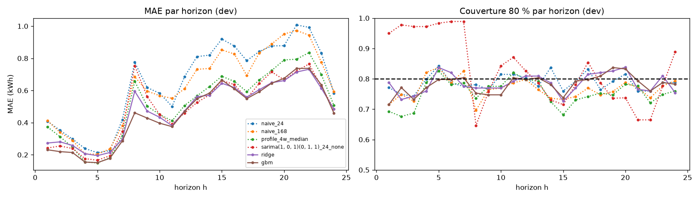
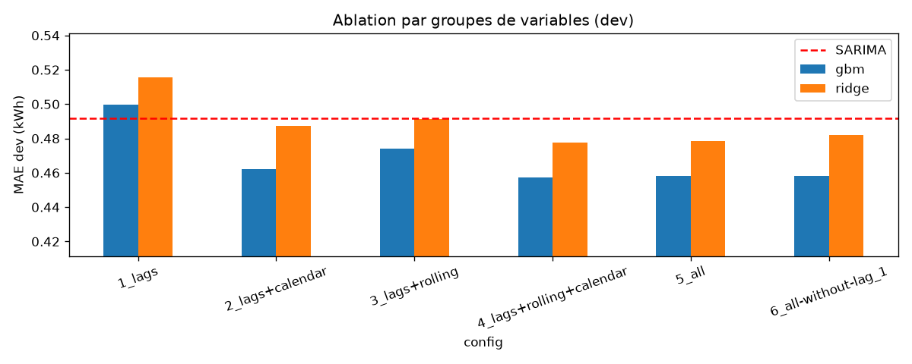
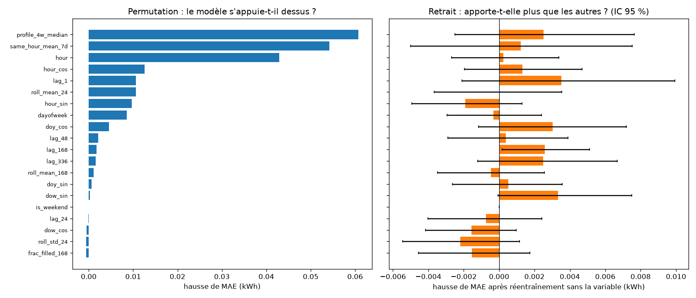

# Phase 5 — Ridge, gradient boosting, ablation et intervalles

*Commande : `python main.py --stage models` · chiffres : `reports/05_models_results.json` · prévisions : `reports/05_forecasts_dev.csv` · figures : `reports/figures/05_*.png` · tests : `tests/test_models.py` (33 tests au total, tous OK).*

## 0. Revue des phases 1 à 4 avant de commencer

| Constat | Gravité | Action |
|---|---|---|
| **Bug d'arrondi** : la date de fin du train (23:59:59) + 1 h donnait 00:59:59, arrondi au jour suivant → le **1ᵉʳ jour du dev-set** (01/12/2009) et de la validation interne (01/09/2009) étaient sautés | 🟠 | Corrigé (`split_origins`), test de non-régression ajouté, phase 3 relancée, rapport 03 mis à jour. Effet : de l'ordre du millième, même sélection |
| Pas de notebooks (structure demandée) | 🟡 | À faire en phase 7 : ils ne feront qu'appeler `src/` |
| Le dossier n'est pas encore un dépôt Git | 🟡 | À créer quand tu le décides (livrable « dépôt GitHub ») |
| Fuites : imputation, variables, validation | ✅ | Couvertes par des tests (causalité du remplissage, « on modifie le jour J », modèle espion) |

## 1. Conception

* **Même pare-feu que les baselines.** À chaque origine, le modèle **recalcule ses variables à partir de l'historique seul**, plus 24 lignes vides pour le jour à prévoir. Il ne lit jamais une matrice précalculée. Un test vérifie que ces variables sont **identiques** à la matrice causale de la phase 4, et qu'une prévision ne change pas quand on modifie le futur.
* **Même protocole** : réglage sur la validation interne au train (01/09 → 30/11/2009), puis dev-set avec réapprentissage tous les 28 jours, gap de 24 h, et **les mêmes 4 282 heures notées pour les 6 modèles**.
* **Ridge** : en plus des 26 variables, des termes **fixes** (sans paramètre appris) : indicatrices d'heure, heure × week-end, **heure × `lag_1`**. Un modèle linéaire peut ainsi dessiner un profil à deux pics et donner à `lag_1` un poids différent selon l'heure. Puis standardisation (apprise sur le train du pli) et pénalité L2.
* **Gradient boosting** (`HistGradientBoostingRegressor`) : `early_stopping` est **désactivé**, car il réserve une part **aléatoire** des lignes, ce qui mélangerait les périodes. Le nombre d'itérations est un hyperparamètre fixé.
* **Intervalle à 80 % conforme par heure** : on réserve les 91 derniers jours de l'historique, on mesure les erreurs d'un modèle entraîné **avant** eux, puis on garde les quantiles 10 % et 90 % de ces erreurs **pour chaque heure**. Le modèle final est réentraîné sur tout l'historique, et ces quantiles sont ajoutés à sa prévision.

## 2. Réglage des hyperparamètres (validation interne au train)

| Modèle | Grille | MAE (validation interne) | Retenu |
|---|---|---|---|
| Ridge | α ∈ {0,1 ; 1 ; 10 ; 100 ; 1000} | 0,4358 à 0,4387 | α = 0,1 |
| Boosting, perte **quadratique** | lr ∈ {0,05 ; 0,1} × feuilles ∈ {15, 63} | 0,427 à 0,438 | — |
| Boosting, perte **absolue** | idem | **0,405** à 0,413 | lr = 0,05, 63 feuilles, 300 itérations |

**Lecture :**
* **La perte absolue gagne nettement** (0,405 contre 0,427). La MAE est minimisée par la **médiane** conditionnelle. La perte absolue vise justement la médiane, alors que la perte quadratique vise la moyenne, tirée vers le haut par la queue droite de la distribution (asymétrie +1,27).
* **α ne change presque rien pour Ridge** (≈ 0,4358 entre 0,1 et 10). Avec environ 24 000 lignes pour environ 100 colonnes, $X^\top X$ domine $\alpha I$. La pénalité ne compte que pour les très grandes valeurs (1000 : 0,4387).

## 3. Résultats sur le dev-set (01/12/2009 → 31/05/2010, 4 282 heures)

| Modèle | MAE (kWh) [IC 95 %] | MASE | Δ MAE vs **SARIMA** [IC 95 %] | Biais (kWh/h) | Couverture 80 % | Largeur | Score d'intervalle |
|---|---|---|---|---|---|---|---|
| naïf-24 | 0,647 [0,603 ; 0,692] | 0,977 | +0,156 | −0,001 | 0,788 | 1,87 | 3,03 |
| naïf-168 | 0,620 [0,574 ; 0,668] | 0,935 | +0,128 | −0,006 | 0,766 | 1,75 | 2,96 |
| profil 4 sem. | 0,517 [0,474 ; 0,564] | 0,780 | +0,025 [+0,005 ; +0,046] | +0,014 | 0,754 | 1,54 | 2,56 |
| SARIMA | 0,492 [0,460 ; 0,525] | 0,742 | — | −0,018 | 0,829 | 1,68 | 2,38 |
| Ridge | 0,479 [0,446 ; 0,512] | 0,722 | −0,013 [−0,026 ; −0,001] | +0,023 | 0,785 | 1,48 | **2,24** |
| **Gradient boosting** | **0,458 [0,426 ; 0,492]** | **0,692** | **−0,033 [−0,053 ; −0,015]** | **+0,080** | 0,781 | **1,44** | 2,25 |

**Ce qu'on peut affirmer :**
* **Le gradient boosting est le meilleur modèle** : −6,7 % de MAE par rapport à SARIMA (IC qui exclut 0) et −29 % par rapport au naïf-24 exigé. Il est le **meilleur sur les 7 plis** (MAE 0,34 à 0,51).
* **Ridge bat SARIMA de justesse** (−2,6 %, IC [−0,026 ; −0,001] : la borne touche presque 0).
* Le gain reste dans la fourchette annoncée **avant** les modèles (5-10 % par rapport à SARIMA). Rien ne fait soupçonner une fuite. Comparer avec la démonstration de fuite au §6, où le « gain » est de −24 %.

**D'où vient le gain ? (par horizon, figure ci-dessous)**
* **h = 7-10 (6 h-9 h), la montée du matin** : c'est là que le boosting gagne le plus. À h = 8 : **0,46** contre 0,75 pour SARIMA et 0,66 pour le profil. Le réveil dépend du **type de jour** (semaine ou week-end), ce que SARIMA, qui ne connaît que les jours précédents, ne peut pas savoir. Le boosting combine l'heure et le jour de la semaine.
* **h = 1-3** : boosting 0,21-0,23, au niveau de SARIMA (0,24-0,25), grâce à `lag_1`.
* **Après-midi et soir (h = 12-23)** : tous les modèles se valent (≈ 0,55-0,74). Ces heures dépendent de décisions du jour même, imprévisibles la veille.

## 4. Intervalles à 80 %

* **Les intervalles conformes par heure règlent le défaut de SARIMA.** Leur couverture reste entre **0,72 et 0,84 à toute heure**. Celle de l'intervalle gaussien de SARIMA va de 0,65 (montée du matin) à 0,99 (nuit).
* **Ils sont plus étroits** (1,44-1,48 kWh contre 1,68) **et meilleurs au score d'intervalle** (2,24-2,25 contre 2,38). Ce score mesure à la fois la largeur et les ratés.
* **Couverture globale de 78 %, un peu sous 80 %.** Les quantiles viennent des 91 jours **avant** chaque pli, et l'erreur change d'une période à l'autre (l'hiver est plus variable). C'est la limite connue du conformal « split » quand les données ne sont pas échangeables dans le temps. Une piste : recalibrer plus souvent (conformal adaptatif).

## 5. Ablation (dev, même protocole, mêmes heures)

| Configuration | Nb var. | Ridge MAE | Boosting MAE | Boosting Δ vs SARIMA [IC 95 %] | Boosting MAE h = 1-3 |
|---|---|---|---|---|---|
| 1. retards seuls | 5 | 0,516 | 0,500 | +0,008 [−0,009 ; +0,025] | 0,264 |
| 2. retards + calendrier | 14 | 0,487 | 0,462 | −0,029 [−0,049 ; −0,009] | 0,220 |
| 3. retards + fenêtres | 11 | 0,491 | 0,474 | −0,017 [−0,035 ; −0,002] | 0,262 |
| **4. retards + fenêtres + calendrier** | 20 | **0,478** | **0,457** | **−0,034 [−0,056 ; −0,014]** | 0,221 |
| 5. tout (+ jours fériés) | 26 | 0,479 | 0,458 | −0,033 [−0,053 ; −0,015] | 0,222 |
| 6. tout **sans `lag_1`** | 25 | 0,482 | 0,458 | −0,033 [−0,053 ; −0,016] | **0,241** |

**Lecture :**
1. **Avec les retards seuls, le boosting ne fait pas mieux que SARIMA** (0,500 contre 0,492, différence non significative). Les deux voient la même information.
2. **Le calendrier est le groupe le plus utile** : −0,038 kWh en l'ajoutant aux retards. C'est l'effet « montée du matin selon le type de jour » vu au §3.
3. **Les fenêtres aident aussi** (−0,026 seules), mais elles recoupent en partie le calendrier : ensemble, elles n'ajoutent que −0,005 par rapport au calendrier seul.
4. **Les jours fériés n'apportent rien de mesurable sur le dev-set** (0,4583 contre 0,4572). C'est cohérent avec la phase 4 : effet réel mais faible (+7 %), et **très peu de fériés** dans le dev-set (25/12, 01/01, 05/04, 13/05, 24/05 en semaine). Le réveillon du 24/12 reste le pire jour, même avec `is_dec24_or_dec31` : un seul exemple par an ne suffit pas pour apprendre.
5. **`lag_1` n'aide que pour les toutes premières heures.** Sans lui, la MAE globale ne bouge pas (0,458), mais la MAE de **h = 1-3 se dégrade de 9 %** (0,221 → 0,241). Pour Ridge, c'est 0,270 → 0,306. C'est exactement ce que prévoyait la phase 4 (corrélation de 0,65 à h = 1, presque 0 à h = 8).

**Importance par permutation** (boosting du 1ᵉʳ pli, hausse de la MAE en kWh quand on mélange la variable) : `profile_4w_median` 0,058 · `same_hour_mean_7d` 0,055 · `hour` 0,043 · `hour_cos` 0,014 · `lag_1` 0,012 · `hour_sin` 0,010 · `roll_mean_24` 0,010 · `dayofweek` 0,007 · `doy_cos` 0,005. Les fériés sont ≈ 0. Attention : `lag_24` et `lag_168` paraissent faibles **parce qu'ils sont redondants** avec les profils (corrélation jusqu'à 0,78). Quand on en mélange un, le modèle se rabat sur l'autre. L'ablation **par groupe** mesure mieux leur apport réel.

## 6. Démonstration de fuite (volontaire, hors protocole)

On reprend le même boosting, mais **en contournant le pare-feu** : il lit une matrice précalculée qui contient $y_{t-1}$ par rapport à la **cible**.

| | MAE dev |
|---|---|
| Boosting légal | 0,458 |
| Boosting **avec fuite** | **0,346** (−24 %) |

La fuite « rapporte » **plus que tous les gains légitimes réunis** (SARIMA → boosting : −7 %). Un tel chiffre dans un rapport **devrait éveiller le soupçon**, et c'est précisément pour cela que l'hypothèse « gain de 5 à 10 % » a été écrite **avant** les modèles. Ce modèle n'est utilisé pour **aucun** choix.

## 7. Grosses erreurs et lecture métier

**Pires jours du boosting** : jeu. 24/12/2009 (1,31 kWh/h), sam. 19/12 (0,99), dim. 02/05 (0,92), lun. 08/03 (0,88), dim. 28/02 (0,87), dim. 21/02 et dim. 20/12. Ce sont les mêmes jours que pour les baselines : réveillon, vacances scolaires, absences, **surtout des week-ends**. Le modèle apprend le week-end « moyen », mais le comportement du week-end est le plus variable (écart-type 12,4 kWh/jour contre 8,7 en semaine, phase 4).

**Le biais de la perte absolue : un point métier important.**
* Le boosting **sous-prévoit de 0,080 kWh/h**, soit **1,9 kWh par jour (6,4 % de l'énergie journalière)**. Ridge, appris avec la perte quadratique, sous-prévoit seulement de 0,5 kWh par jour.
* C'est **voulu par la perte absolue** : elle vise la **médiane**, qui est sous la moyenne quand la distribution est asymétrique à droite. L'erreur horaire médiane du boosting est d'ailleurs ≈ 0 (+0,016).
* **Conséquence** : le boosting est le meilleur pour **chaque heure** (MAE), mais pour le **volume total** à réserver (contrat, achat d'énergie), il réserverait trop peu. En sous-prévision, l'énergie manquante s'achète au prix fort. **La métrique doit suivre la décision** :
  * prévoir le profil horaire (pilotage, MAE) → **perte absolue** ;
  * prévoir le **volume** du contrat → perte quadratique (moyenne), ou boosting + correction de biais apprise sur la fenêtre de calibration ;
  * se couvrir contre le risque de manque → la borne **haute** de l'intervalle à 80 %.

## 8. Choix pour l'évaluation finale (phase 6), fixé maintenant, avant le test

**Règle fixée à l'avance** : le meilleur MAE sur le dev-set ; à égalité statistique, le modèle le **plus simple**.
* **Modèle retenu : gradient boosting, configuration 4 (retards + fenêtres + calendrier, 20 variables)**, perte absolue, lr 0,05, 63 feuilles, 300 itérations, intervalle conforme par heure. C'est la plus petite MAE (0,457), avec 6 variables de moins que la configuration complète, pour la même performance.
* **Références rapportées sur le test** : naïf-24 (exigé), SARIMA (exigé) et Ridge, avec le **même protocole**. Ridge et SARIMA sont réentraînés sur train + dev, comme le boosting.
* **Réservé, non réglé** : correction du biais de volume. On **rapportera** le biais du test, sans le corriger après coup.

## 9. Revue des 20 variables du modèle retenu (analyse descriptive, dev-set)

*Commande : `python main.py --stage feature_review` · chiffres : `reports/05b_feature_review.json` · figure : `reports/figures/05b_feature_importance.png`.*

Ce n'est **pas** une sélection de variables : le modèle final est figé (phase 6). On décrit ce que chaque variable apporte. Un seul entraînement sur le train (gap de 24 h), évaluation sur les 4 282 heures du dev-set, MAE de référence **0,458**. Le test n'est pas lu.

| Mesure | Question | Résultat principal |
|---|---|---|
| **Permutation** (10 répétitions) | le modèle s'appuie-t-il sur la variable ? | `profile_4w_median` 0,060, `same_hour_mean_7d` 0,053, `hour` 0,042, `hour_cos` 0,011, `lag_1` 0,011, `roll_mean_24` 0,011, `hour_sin` 0,010 ; le reste < 0,01 |
| **Retrait d'une variable** (réentraînement) | apporte-t-elle plus que les autres ? | une seule variable a un IC qui exclut 0 : **`lag_168`** (+0,003 [+0,000 ; +0,005]) ; **`is_weekend` n'est jamais utilisée** (0 et 0) |
| **Retrait d'un groupe** | l'information est-elle indispensable ? | **seul le groupe heure** : +0,017 [+0,008 ; +0,026] ; jour +0,002, saison +0,001, retards +0,003, profils −0,001, fenêtres 0,000 (tous avec un IC qui contient 0) |

**Ensembles réduits :**

| Variables | MAE dev | Écart avec 20 variables [IC 95 %] |
|---|---|---|
| 20 (modèle retenu) | 0,458 | — |
| 8 (une par information) | 0,459 | +0,001 [−0,005 ; +0,008] |
| 5 | 0,466 | +0,008 [−0,001 ; +0,018] |
| 3 (profils + heure) | 0,472 | +0,015 [+0,004 ; +0,025] — mais toujours meilleur que SARIMA (0,492) |

**Lecture :**
* **Forte redondance.** Une même information passe par plusieurs variables. Le motif de la semaine, par exemple, est porté par `dayofweek`, `lag_168`, `lag_336` et `profile_4w_median`. Quand on en retire une, le modèle utilise une autre. C'est pourquoi la permutation (forte pour les profils) et le retrait (≈ 0) ne disent pas la même chose.
* **Une seule information est irremplaçable : l'heure de la journée.**
* **8 variables suffiraient** pour la même performance. `is_weekend` (redondante avec `dayofweek ≥ 5`), `roll_std_24`, `frac_filled_168` et `doy_sin` n'apportent rien de mesurable.
* `frac_filled_168` devait apprendre au modèle à se méfier des valeurs remplies. Sur le dev-set, il y a trop peu de trous (86 heures) pour qu'il l'apprenne, et sur le test le boosting perd 18 % après les longs trous (phase 6). C'est une **limite**.
* **Pourquoi garder 20 variables ?** La sélection a été faite **par groupes**, avec une règle fixée à l'avance. Une sélection variable par variable aurait demandé une validation imbriquée. Les variables redondantes ne nuisent pas : le boosting les ignore. Et le modèle ne peut plus changer, puisque le test a été vu. Les conclusions « 8 variables suffisent » relèvent donc des **travaux futurs**, à valider sur de nouvelles données.
